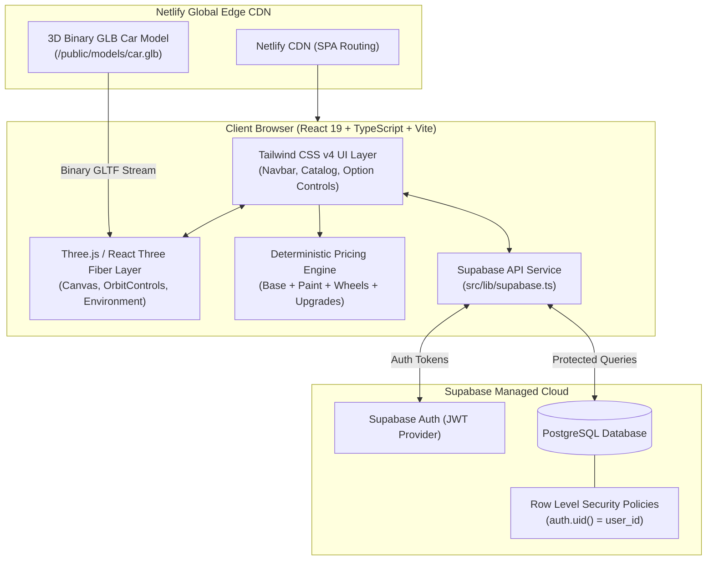

# ProductVision — 3D Product Visualization & Configurator

> **BTech Information Technology Major Project**  
> **Topic 3**: 3D Product Visualization and Configurator  
> **Stack**: React 19, TypeScript, Vite 8, Tailwind CSS v4, Three.js, React Three Fiber, Supabase PostgreSQL, Netlify

---

## 1. Project Overview

**ProductVision** is a production-grade, interactive 3D product customization web application. Engineered as an IT capstone project, it combines real-time WebGL rendering with a relational cloud database, strict Row Level Security (RLS), and a deterministic pricing ledger.

### Key Capabilities:
* **Interactive 3D WebGL Studio**: 360° mouse/touch rotation, zoom, studio lighting presets (Studio, Sunset, Cyber), wireframe mesh view, and multi-angle camera presets (Perspective, Front, Side, Rear).
* **Live Material & Paint Laboratory**: Real-time shader adjustments for metallic, gloss, and matte car paints, customized wheel finishes, and brake caliper recoloring.
* **Deterministic Pricing Engine**: Mathematical price calculations with itemized line items (Base Vehicle MSRP + Selected Paint + Wheel Package + Upgrades = Total MSRP).
* **Supabase Authentication**: User registration and login powered by JSON Web Tokens (JWT).
* **Cloud PostgreSQL with Row Level Security (RLS)**: Isolated database records ensuring users can only read, update, duplicate, or delete their own custom configurations.
* **Build Comparison Suite**: Side-by-side comparison of 2 or 3 saved vehicle builds with visual swatches, performance metrics, and price difference analysis.
* **Printable Specification Sheet**: Instant client-side generation of itemized specification sheets with PDF printing support.

---

## 2. System Architecture



---

## 3. Technology Stack

| Layer | Technology | Rationale / Purpose |
| :--- | :--- | :--- |
| **Frontend Framework** | **React 19** (`^19.3.1`) | Component modularity and declarative UI state synchronization |
| **Type System** | **TypeScript 5.9** | Strict type safety with `verbatimModuleSyntax` |
| **Build Tool** | **Vite 8** (`^8.3.4`) | High-speed Hot Module Replacement (HMR) and optimized Rollup code splitting |
| **Styling** | **Tailwind CSS v4** (`@tailwindcss/vite`) | Modern CSS-first utility classes with zero PostCSS boilerplate |
| **3D Rendering** | **Three.js** & **React Three Fiber** (`v9`) | Declarative WebGL scene graph, camera controls, and lighting |
| **3D Helpers** | **@react-three/drei** (`v10`) | `OrbitControls`, `useGLTF`, `ContactShadows`, and `Environment` |
| **Database & Auth** | **Supabase** (`PostgreSQL 15`) | Managed SQL database with automatic triggers and Row Level Security |
| **Deployment** | **Netlify** | Global Edge CDN with continuous deployment from GitHub |

---

## 4. Database Schema & Row Level Security (RLS)

The database schema is defined in [`supabase/migrations/20261019_initial_schema.sql`](supabase/migrations/20261019_initial_schema.sql).

### Relational Tables:
1. **`public.profiles`**:
   * Linked 1-to-1 with `auth.users(id)` via Foreign Key with `ON DELETE CASCADE`.
   * Automatically populated on user signup via the PostgreSQL trigger `on_auth_user_created`.
2. **`public.products`**:
   * Catalog of customizable vehicles (slug, category, base price, specs, color palettes, wheel options, upgrades).
   * Open read-access policy for public viewing.
3. **`public.configurations`**:
   * Stores user customized builds (`user_id`, `product_id`, `title`, `selected_color`, `selected_wheel`, `selected_add_ons`, `total_price`).
   * Foreign keys enforce relational integrity.

### Row Level Security (RLS) Policies:
```sql
-- Strict user isolation on configurations
create policy "Users can view their own configurations"
  on public.configurations for select
  using (auth.uid() = user_id);

create policy "Users can insert their own configurations"
  on public.configurations for insert
  with check (auth.uid() = user_id);

create policy "Users can update their own configurations"
  on public.configurations for update
  using (auth.uid() = user_id);

create policy "Users can delete their own configurations"
  on public.configurations for delete
  using (auth.uid() = user_id);
```

---

## 5. Local Setup & Installation

### Prerequisites
* **Node.js**: v18.0.0 or later (tested on v24.22.0)
* **npm**: v9.0.0 or later (tested on v11.19.1)
* **Git**: Installed and in PATH

### Quickstart
1. **Clone the repository**:
   ```bash
   git clone https://github.com/your-username/productvision.git
   cd productvision
   ```

2. **Install dependencies**:
   ```bash
   npm install
   ```

3. **Configure Environment Variables**:
   Copy `.env.example` to `.env`:
   ```bash
   cp .env.example .env
   ```
   Add your free Supabase project credentials:
   ```env
   VITE_SUPABASE_URL=https://your-project-id.supabase.co
   VITE_SUPABASE_ANON_KEY=eyJhbGciOiJIUzI1NiIsInR5cCI6IkpXVCJ9...
   ```
   *(If left empty, ProductVision automatically operates in verified local preview mode).*

4. **Run the local development server**:
   ```bash
   npm run dev
   ```
   Open `http://localhost:5173` in your browser.

5. **Build for Production**:
   ```bash
   npm run build
   ```

6. **Run ESLint Code Quality Verification**:
   ```bash
   npm run lint
   ```

---

## 6. Netlify Public Deployment Guide

ProductVision is pre-configured with [`netlify.toml`](netlify.toml) and [`public/_redirects`](public/_redirects) for production deployment.

### Step-by-Step Deployment:
1. **Push your code to GitHub**:
   ```bash
   git add .
   git commit -m "feat: complete ProductVision full-stack 3D configurator"
   git remote add origin https://github.com/your-username/productvision.git
   git push -u origin main
   ```
2. Log in to **[Netlify](https://www.netlify.com/)** and click **"Add new site"** $\rightarrow$ **"Import an existing project"**.
3. Select **GitHub** and choose your `productvision` repository.
4. Netlify will automatically detect the build configuration from `netlify.toml`:
   * **Build command**: `npm run build`
   * **Publish directory**: `dist`
5. Click **"Environment variables"** and add:
   * `VITE_SUPABASE_URL`: `https://your-project-id.supabase.co`
   * `VITE_SUPABASE_ANON_KEY`: `eyJhbGciOiJIUzI1NiIsInR5cCI6IkpXVCJ9...`
6. Click **"Deploy site"**. Your application will be live at `https://your-site-name.netlify.app`!

---

## 7. Viva Defense & Technical Q&A Guide

### Q1: Why use React Three Fiber instead of vanilla Three.js?
> **Answer**: Vanilla Three.js is imperative; managing object creation, render loops, camera positions, and material updates requires manual DOM event binding and memory disposal. React Three Fiber brings Three.js into the declarative React paradigm. When a user clicks a color swatch, the state update automatically triggers a re-render of only the affected mesh materials without re-instantiating the WebGL context or reloading the geometry.

### Q2: How does the application ensure user data isolation?
> **Answer**: Through PostgreSQL **Row Level Security (RLS)** in Supabase. Rather than relying solely on frontend filtering, the database engine inspects the JWT cryptographic signature passed in the request header (`auth.uid()`). A user is mathematically prohibited from querying or mutating another user's rows.

### Q3: What is the deterministic pricing engine and why is it important?
> **Answer**: In configurator systems, price calculation must be transparent, verifiable, and free of floating-point inaccuracies. The pricing engine takes the base vehicle price and sums the exact pricing deltas of the selected paint finish, wheel dimensions, and package options to generate an itemized financial ledger.

---

## 8. License & Academic Attribution
* **Project**: BTech Information Technology Major Project
* **3D Asset**: Official Three.js binary vehicle model (`car.glb`), MIT License.
* **Codebase**: MIT License. Developed for academic demonstration and research.
